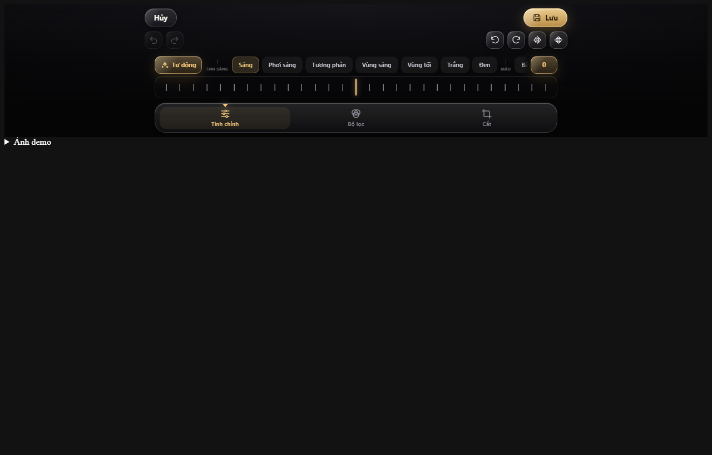

# Aurum

**A lightweight web image editor (~59 KB gzip) with a headless TypeScript core and an optional iOS-style dark/gold UI.**

Aurum is a dependency-free crop / rotate / adjust / filter / beauty / export engine for the browser. The preview is rendered on the GPU (WebGL 1) or Canvas2D, gestures are physics-based, and the full-resolution export is sampled from the original bitmap only when you save.

- **58.6 KB gzip** ESM JS (58.8 KB CJS/IIFE) · **6.7 KB gzip** CSS
- **1.9 KB gzip** optional Beauty mask module, **4.3 KB gzip** optional AI adapter, **2.1 KB gzip** optional landmark adapter
- **9 prebuilt GLSL variants** compiled at build time; one draw call, no runtime GLSL assembly
- **0 runtime dependencies** — esbuild and TypeScript are dev-only
- **Headless core** — bring your own UI, or use the included dark/gold one
- **60–120 FPS** preview at DPR up to 3
- **Vietnamese UI by default** (`locale: 'en'` switches to English)
- Full-resolution export to Blob, DataURL, File or ImageData

The demo UI is a compact Liquid Glass panel: a two-row header, a transparent three-row dock, tick-style controls, and a crop frame you can resize from any edge or corner. The library itself fills any container.

---

## Quick start

### Bundler / ESM

```bash
npm install aurum-image-editor
```

```ts
import { createEditor } from 'aurum-image-editor';

const editor = createEditor({
  container: '#editor',
  image: './photo.jpg',
  fileName: 'holiday',
  locale: 'vi',
  onSave(blob, fileName) {
    // Upload the blob or show your own preview. Without this callback Aurum
    // downloads the file automatically.
    console.log(fileName, blob.size);
  },
});
```

The stylesheet is injected once by default. To ship it yourself instead:

```ts
import 'aurum-image-editor/aurum.css';
import { createEditor } from 'aurum-image-editor';

const editor = createEditor({ container: '#editor', injectStyles: false });
```

### Script tag

```html
<div id="editor" style="height: 100dvh"></div>
<script src="aurum.min.js"></script>
<script>
  const editor = Aurum.createEditor({
    container: '#editor',
    image: './photo.jpg',
  });
</script>
```

The IIFE build exposes `Aurum.createEditor`, `Aurum.createCore`, `Aurum.AurumEditor`, `Aurum.AurumCore` and the state/color helpers.

### Headless core

```ts
import { createCore } from 'aurum-image-editor';

const core = createCore({
  container: '#stage',          // gets an absolutely positioned <canvas>
  image: file,                  // URL, Blob, File, ImageBitmap,  or <canvas>
  maxPreview: 1080,
  maxZoom: 8,
  maxExport: 8192,
});

core.on('ready', async ({ width, height }) => {
  console.log('source:', width, height);
  core.setAspect('1:1');
  core.rotateBy(90);
  core.setFilter('vivid');
  core.setAdjust('warmth', 25);

  const blob = await core.export({ type: 'image/webp', quality: 0.9 });
  console.log(core.getExportSize(), blob.size);
});
```

`AurumCore` contains no UI code: it creates a stage and a canvas, listens for pointer/wheel gestures, and emits state. Layout is your responsibility; it fills the container.

---

## Features

### Crop
- Fixed centre crop frame, so the image moves under a stable composition
- Free ratio, `1:1`, `4:3`, `3:4`, `16:9`, `9:16`, and current-screen ratio
- Frame scale from 20% to 100% of the padded viewport
- Pinch zoom, drag pan, wheel zoom, double-tap zoom
- Rubber-band overshoot at the bounds with a 380–420 ms spring settle
- Free rotation −180°…180°, 90° steps, horizontal/vertical flip
- Every crop corner is clamped to the source image, including at arbitrary rotation

### Adjust
`brightness`, `contrast`, `saturation`, `exposure`, `warmth`, `tint`, `vibrance`, `gamma`, `highlights`, `shadows`, `whites`, `blacks`, `clarity`, `sharpen`, `denoise`, `smoothSkin`, `blemish`, `skinTexture`, `skinTone`, `faceSlim`, `jawline`, `chin`, `eyeSize`, `noseSize`, `mouthSize` (−100…100) and `vignette` (0…100).

On the WebGL path, preview and export share one colour pipeline and the same vignette formula, so what you see is what you save. The Canvas2D fallback uses CSS filter approximations for the same adjustments; those are visually close but not bit-identical to the WebGL output when adjustments are non-identity.

### Beauty (optional)
`aurum-beauty.esm.js` is a separate 1.9 KB gzip module. It builds a small RGBA mask from the source bitmap and optional face boxes:

```
Image → buildBeautyMask(bitmap, { faces }) → core.setBeautyMask(mask)
```

- `R` = skin, `G` = protected features (eyes, eyebrows, hair, beard), `B` = lips
- Skin colour is learned from cheek/forehead samples inside detected faces, so dark skin and skin-coloured backgrounds do not collapse into one class
- The mask guides edge-aware smoothing, blemish removal and skin-tone correction
- Eyes, brows, hair and lips are excluded from smoothing; texture preservation keeps pores and fine grain
- `blemish` uses an unweighted UV-space ring, so a spot is removed identically in the preview and the full-resolution export
- Face boxes are optional. Without them the mask falls back to a conservative fixed YCbCr window
- Without the module the core keeps its procedural shader mask, so the editor still works everywhere

### Face geometry and liquify
Six UV-space sliders reshape the face in the same single draw call: `faceSlim`, `jawline`, `chin`, `eyeSize`, `noseSize`, `mouthSize`.

- The shader uses an analytic inverse warp: it maps the destination UV to a source UV, then samples texture and mask at that point.
- Anchors come from the existing `u_faces` ellipses, so the sliders work without a landmark model.
- Outside the face ellipse the displacement is zero. There is no mesh, no extra pass, and no preview/export difference.
- Positive values slim the face/jaw, lengthen the chin, and enlarge eyes/nose/mouth; negative values reverse each effect.

### Face landmarks (optional)
`aurum-landmarks.esm.js` is a separate 2.1 KB gzip module. It lazily loads a self-hosted MediaPipe Face Landmarker fileset, measures a 478-point mesh, and returns one anchor record per face:

```ts
const anchors = await detectFaceAnchors(bitmap, {
  moduleUrl: '/assets/landmarks/vision_bundle.js',
  modelUrl: '/assets/landmarks/face_landmarker.task',
  wasm: {
    loaderUrl: '/assets/landmarks/simd/vision_wasm_internal.js',
    binaryUrl: '/assets/landmarks/simd/vision_wasm_internal.wasm',
  },
  nosimd: {
    loaderUrl: '/assets/landmarks/nosimd/vision_wasm_nosimd_internal.js',
    binaryUrl: '/assets/landmarks/nosimd/vision_wasm_nosimd_internal.wasm',
  },
});
core.setFaces(anchors.map((anchor) => anchor.box));
core.setFaceAnchors(anchors);
closeFaceLandmarker(); // free the WASM heap; the module stays cached
```

- A 4×4 RGBA8 anchor texture carries eye/nose/mouth positions and radii; positions use the face-local −1…1 space, so the core keeps its single draw call and does not add uniform arrays.
- The module downscales the source to at most 960 px, runs CPU IMAGE mode for up to four faces, and closes the MediaPipe instance after each still image.
- `setFaceAnchors(null)` / `clearFaceAnchors()` restore the server face boxes and the shader's procedural anchors. A missing module, a blocked WASM compile or a failed detection never disables the six sliders.
- The ESM fileset file must be served as JavaScript (`.js`), not `.mjs` on servers that return `text/plain`; WebAssembly needs `script-src 'wasm-unsafe-eval'` in the document CSP.

Free liquify is a brush that stores dabs in source UV:

```ts
core.addLiquifyDab({ x, y, dx, dy, radius }); // x/y/dx/dy/radius in source UV
core.clearLiquify();
core.getLiquify();   // cloned dab array
core.hasLiquify();
```

- The dabs rebuild a 64 px RGBA8 displacement field, applied before the face warp.
- R/G encode `128 + value / shift * 127`; 128 is exact zero, so untouched texels do not drift.
- Caps: 640 dabs, 0.09 UV max shift, 0.35 UV max radius.
- `sourcePointAt(clientX, clientY)` and `screenPointAt(u, v)` map between DOM pointer pixels and source UV through result mode, rotation, flips and perspective.
- In the UI, the **Liquify** chip appears after the face-shape controls. It swaps the value ruler for a brush-size ruler, shows a ring cursor, and clears with one tap. Dabs from one stroke coalesce into one history entry for 900 ms.

### Shader variants (build time)

The fragment pipeline is assembled from GLSL modules at build time; the browser only links prebuilt strings.

| Variant | Linear | Beauty mask | Liquify |
| --- | :-: | :-: | :-: |
| `base` | — | — | — |
| `base-linear` | ✓ | — | — |
| `base-liquify` | — | — | ✓ |
| `base-linear-liquify` | ✓ | — | ✓ |
| `beauty-gamma` | — | ✓ | — |
| `beauty-gamma-liquify` | — | ✓ | ✓ |
| `beauty` | ✓ | ✓ | — |
| `beauty-liquify` | ✓ | ✓ | ✓ |
| `fallback` | minimal colour + vignette only |

- `shaderVariantFor(linear, mask, liquify)` picks one variant per draw; the fast path is still one draw call.
- Compile-time defines are `AURUM_LINEAR`, `AURUM_BEAUTY_MASK` and `AURUM_LIQUIFY`. Landmark anchors stay a runtime uniform branch because they change per image.
- Linked programs are cached by variant. If a variant fails to compile, Aurum logs the variant and driver log, then falls back to `base` and finally to the minimal `fallback`; the UI is never blocked.
- `npm run build:shaders` regenerates `src/core/shader/generated.ts` and writes readable `dist/shaders/*.glsl` plus `manifest.json`. `npm run build` runs it automatically.
- The nine sources total **120.6 KB raw**; because they share most modules, they add only **5.8 KB gzip** to the core bundle.

### Filters
`original`, `vivid`, `dramatic`, `mono`, `vintage`, `warm`, `cool`.

Preset thumbnails are generated at 128 px from the loaded preview, so they match the actual image.

### History
- 60 entries by default (`maxHistory`)
- Slider bursts coalesce into one entry using a 900 ms key window
- Undo/redo with buttons and `Ctrl/Cmd+Z`, `Ctrl/Cmd+Shift+Z`, `Ctrl/Cmd+Y`
- Optional JSON import/export for non-destructive sessions

### Export
- `image/jpeg`, `image/webp`, `image/png`
- Quality 5–100% (JPEG/WebP)
- `Blob`, `DataURL`, `File`, `ImageData`
- Full-resolution path reads the original bitmap, not the 1080 px preview
- Output capped at `maxExport` pixels per side (8192 by default); aspect ratio preserved
- If the browser cannot encode the requested type (for example old WebP encoders), Aurum rejects with a clear error instead of silently returning PNG bytes under a `.webp` name.

---

## UI options

```ts
interface AurumUIOptions extends AurumCoreOptions {
  container: HTMLElement | string;
  locale?: 'vi' | 'en';          // default 'vi'
  title?: string;                // accessible header label
  fileName?: string;             // export base name
  theme?: Record<string, string>;// CSS variables, e.g. { gold: '#f3c77b' }
  onSave?: (blob: Blob, fileName: string) => void;
  onClose?: () => void;          // called by the Cancel (Hủy) button
  autoDownload?: boolean;        // default true; ignored when onSave is set
  startTab?: 'crop' | 'adjust' | 'filter';
  injectStyles?: boolean;        // default true
}
```

`theme` keys may be full custom properties or short names. `{ gold: '#7cd6ff' }` becomes `--au-gold`; `{ '--au-panel': 'rgba(...)' }` is used as-is. Useful variables:

| Variable | Purpose |
| --- | --- |
| `--au-bg`, `--au-bg-2` | editor background |
| `--au-panel` | reserved panel glass tint |
| `--au-gold`, `--au-gold-strong`, `--au-gold-soft` | accent |
| `--au-text`, `--au-muted` | text |
| `--au-line`, `--au-danger` | dividers and errors |

Programmatic UI controls:

```ts
editor.showTab('adjust');
editor.openExport();
editor.destroy(); // disposes listeners, bitmaps, GL resources and the root node
```

---

## Core options

| Option | Default | Description |
| --- | --- | --- |
| `container` | — | Element or selector. Aurum sets `position: relative` when needed. |
| `image` | — | Optional initial source. |
| `maxPreview` | `1080` | Longest side of the preview bitmap. |
| `maxHistory` | `60` | History entries (minimum 2). |
| `maxZoom` | `8` | Maximum gesture zoom. |
| `maxExport` | `8192` | Maximum output pixels per side. |
| `colorSpace` | `auto` | `auto` enables the hybrid linear-light pipeline on `highp` GPUs; `srgb` forces the legacy gamma path and `linear` forces linear-light. |
| `dither` | `auto` | 4×4 Bayer output dither. `auto` enables it for linear output and low-tier devices. |
| `previewQuality` | `fast` | `fast` uses 4-tap spatial filters; `high` uses 8-tap. |
| `background` | `#08080a` | Stage background; the UI passes `transparent`. |

## Core API

| Method | Description |
| --- | --- |
| `load(source)` / `setImage(source)` | Load a URL, blob, file, bitmap, image or canvas. Replaces the current image and resets state. |
| `getState()` | Deep copy of the current state. |
| `setState(state, opts?)` | Normalise and apply state. `opts.history: false` skips the history entry; `opts.silent` suppresses `change`/`history` events (rendering still emits `render`). |
| `exportState()` / `importState(json)` | JSON envelope round-trip (`{ version: 1, state }`). |
| `setAdjust(key, value, coalesceKey?)` | Clamp and apply one adjustment. |
| `resetAdjust(key)` / `resetAdjustments()` | Reset one or all adjustments. |
| `setFilter(id)` | Apply a preset by id; unknown ids fall back to `original`. |
| `setColorSpace('auto' \| 'srgb' \| 'linear')` | Switch the colour pipeline; applied to preview and export. |
| `setDither('auto' \| boolean)` | Force output dither on or off. |
| `setAspect(aspect)` | `free`, `1:1`, `4:3`, `3:4`, `16:9`, `9:16`, `screen`. |
| `setCrop({ ratio?, scale?, aspect? })` | Combined crop changes. |
| `setRotation(deg)` / `rotateBy(deg)` | Absolute or relative rotation, normalised to −180…180. |
| `flip('h' \| 'v')` | Flip an axis. |
| `resetCrop()` / `reset()` | Reset crop only, or everything. |
| `undo()` / `redo()` / `canUndo()` / `canRedo()` | History. |
| `viewport()` / `source()` / `getFrame()` | CSS-pixel viewport, source size, and the current crop frame. |
| `getExportSize()` | Exact pixel dimensions the next export would produce. |
| `export(opts)` | `Promise<Blob>`; `{ type, quality }`. |
| `toDataURL(opts)` | `Promise<string>` data URL. |
| `toFile(name?, opts?)` | `Promise<File>`. |
| `getImageData(opts?)` | `Promise<ImageData>` (PNG encode → decode). |
| `getPreviewBitmap()` | The 1080 px preview bitmap, if ready. |
| `sourceBitmap()` | The loaded full-resolution bitmap. Treat it as read-only. |
| `setFaces(faces)` / `clearFaces()` / `getFaces()` | Normalised face boxes from a detector; used by the procedural skin mask and the Beauty module. `setFaces()` also drops active landmark anchors. |
| `setFaceAnchors(anchors \| null)` / `clearFaceAnchors()` / `hasFaceAnchors()` | Attach refined landmark anchors (packed into a 4×4 RGBA8 texture); `null` restores the server boxes and procedural anchors. |
| `setBeautyMask(mask \| null)` / `getBeautyMask()` | Attach or clear the optional RGBA beauty mask (`R` skin, `G` features, `B` lips). |
| `addLiquifyDab(dab, coalesce?)` / `clearLiquify()` | Append a source-UV liquify dab, or remove every dab. Dabs share a history key while one stroke is active. |
| `getLiquify()` / `hasLiquify()` | Cloned dab array, or whether any dab exists. |
| `sourcePointAt(x, y)` / `screenPointAt(u, v)` | Map DOM pointer pixels to source UV and back, including result view, rotation, flips and perspective. |
| `on(name, fn)` / `off(name, fn)` | Subscribe/unsubscribe; `on` returns an unsubscribe function. |
| `destroy()` | Release bitmaps, GL objects, observers, gestures and DOM. |
| `isReady` / `isLoading` / `accelerated` | Read-only status. |

## State format

```json
{
  "version": 1,
  "transform": {
    "zoom": 1.25,
    "rotation": 12,
    "flipH": false,
    "flipV": false,
    "offsetX": 0.08,
    "offsetY": -0.04
  },
  "crop": {
    "aspect": "4:3",
    "ratio": 1.5,
    "scale": 0.85
  },
  "adjust": {
    "brightness": 8,
    "contrast": 12,
    "saturation": 18,
    "exposure": 0,
    "warmth": 10,
    "vignette": 20
  },
  "filter": "vivid",
  "retouch": {
    "liquify": [{ "x": 0.5, "y": 0.5, "dx": 0.03, "dy": 0, "radius": 0.12 }]
  }
}
```

`offsetX` / `offsetY` are normalised image-local units (the image quad is −1…1). Keeping them local makes bounds axis-aligned even when the image is rotated. Liquify dabs are also in source UV, so a saved session reopens at any preview size. State is non-destructive: the source bitmap is never modified.

## Events

| Event | Payload |
| --- | --- |
| `ready` | `{ width, height }` of the source |
| `change` | `EditorState` |
| `history` | `{ canUndo, canRedo }` |
| `render` | `{ frame }` |
| `loading` | `{ loading }` |
| `error` | `{ error }` |
| `export` | `{ blob }` |

Listener exceptions are swallowed so a UI bug cannot break the render loop.

---

## Gestures and keyboard

- One finger drags the image; release settles it inside the crop bounds.
- Two fingers pinch-zoom around the midpoint. Past the limits, zoom follows a rubber-band curve and springs back on release.
- Wheel zooms around the cursor; the spring starts 220 ms after the last wheel event.
- Double-tap toggles between the minimum zoom and `2.2 × minimum`, anchored on the tap.
- `Escape` closes the export sheet; `Tab` is trapped inside it while open.
- Arrow keys, `Home` and `End` move between Crop, Adjust and Filters.
- A focused tick slider uses arrow keys to change its value, `PageUp`/`PageDown` for larger steps, and `Home`/`End` for the range ends.
- A focused crop frame resizes with the arrow keys; hold `Shift` for larger steps.
- `Ctrl/Cmd+Z` undoes, `Ctrl/Cmd+Shift+Z` or `Ctrl/Cmd+Y` redoes.

The stage sets `touch-action: none`, disables text selection, and captures pointers, so browser scroll and pull-to-refresh do not fight the editor.

---

## Accessibility

- Tabs use `role="tablist"` / `aria-selected` and roving focus with arrow-key navigation.
- Every tick control is a `role="slider"` with `aria-valuemin`, `aria-valuemax`, `aria-valuenow` and `aria-valuetext`; filter and tool buttons expose their visible labels.
- The export sheet is a modal dialog with `aria-modal`, focus trapping, `Escape` to close, and focus returned to the Save button.
- `prefers-reduced-motion: reduce` collapses animations and transitions.
- `prefers-reduced-transparency: reduce` removes backdrop blur and falls back to solid surfaces; `prefers-contrast: more` strengthens borders and ticks.
- Focus rings are visible for keyboard users.
- The crop frame is a focusable group with arrow-key resizing and an `aria-label` describing the shortcuts. The four corner and four edge handles are pointer affordances; the frame, ratio chips and rotation slider cover keyboard use.
- Tick crossings request a 3 ms haptic pulse through `navigator.vibrate` where the browser supports it; it is a progressive enhancement.
- The **Liquify** chip exposes `aria-pressed` and an accessible label; leaving Adjust or selecting another control turns it off and releases pointer capture.

## Browser support

Modern evergreen browsers with ES2020. Preview uses WebGL 1 when available and falls back to Canvas2D. `ResizeObserver` is used when present, with a `window.resize` fallback. `createImageBitmap` is preferred but not required. WebP export depends on the browser encoder; JPEG and PNG are effectively universal. If the GPU drops its WebGL context, the preview pauses and redraws automatically when the browser restores it.

Known limits:

- Previews are capped at 1080 px on the longest side; full resolution is reserved for export.
- WebGL textures larger than 8192 px are downscaled for export on GPUs with that limit. The output is still capped by `maxExport`.
- Cross-origin URLs must be served with CORS headers, otherwise the browser refuses to read the pixels.
- No text, stickers, drawing, multi-image collage or cloud sync — Aurum is deliberately a focused crop/adjust/export engine.

---

## Standalone host page (`editor.html`)

`editor.html` at the repo root is a ready-to-serve host page that embeds the
built engine from `assets/` (copied from `dist/` — see `npm run sync:assets`).
It reads its config from the
`<script type="application/json" id="editor-config">` block:

| key | meaning |
| --- | --- |
| `id` | item identifier echoed back on save |
| `csrf` | csrf token included in the upload form |
| `saveUrl` | POST endpoint accepting `FormData { csrf, id, mode, file }`; returns `{ ok: true, id }` |
| `returnUrl` | where the page goes after a save (in a full app) |
| `viewUrl` | where "close" goes back to |
| `mediaUrl` | source image URL (serve the full-resolution original here) |
| `name` / `stem` / `uploadName` | file naming for export |
| `exportType` | MIME to export (`image/jpeg` / `image/png` / `image/webp`) |
| `heic` | true when the source is HEIC/HEIF (exporter note explains the server round-trip) |
| `width` / `height` | source dimensions |
| `faces` | optional server-side face boxes (`{x,y,w,h,confidence}`) steering the portrait sliders |
| `ai` / `aiHigh` | availability of the AI upscale module + ONNX models |
| `landmarks` | optional Face Landmarker module/model URLs (MediaPipe fileset), else server boxes only |
| `*Ver` | asset versioning for cache-busting |

`saveUrl` receives `mode: "overwrite"` or `"copy"`. This is the exact
contract the MNG Cloud PHP app historically used; the native
`POST /api/v1/items/{id}/edit` route accepts the same multipart shape
(with an `x-csrf-token` header instead of the form csrf field).

Serve the repo statically and open `editor.html`:

```
python3 -m http.server 8000
# open http://localhost:8000/editor.html
```

A floating **"Ảnh demo"** panel (top-left) picks from the bundled sample
photos in `demo/`, or use `?src=<url>` to load an arbitrary image.
The demo harness installs the Trusted Types shims
(`assets/demo-shim.js`) separately so the engine works under a
`require-trusted-types-for 'script'` CSP.



### Layout

```
src/                       TypeScript source (headless core + optional UI)
scripts/build-shaders.mjs  build-time GLSL module compiler
build.mjs                  esbuild bundles → dist/
dist/                      build output (not committed)
assets/                    host-page copies of dist/*.esm.js + aurum.css,
                           plus the host bridge (editor.js, demo-*.js)
editor.html                standalone host page (see above)
demo/                      full-UI + headless demos, sample photos,
                           screenshots
test-*.html, test-assets/  regression pages and fixtures
ARCHITECTURE.md            renderer, geometry, gestures, export pipeline
```

---

## Development

```bash
npm install
npm run check         # build (incl. shader variants) + typecheck + size report
npm run build:shaders # regenerate generated.ts + dist/shaders snapshots only
npm run demo          # python -m http.server 4173
```

Open `http://localhost:4173/demo/` for the full UI, or `http://localhost:4173/demo/headless.html` for a core-only example.

Regression pages: `test-color.html`, `test-beauty.html`, `test-face.html`, `test-liquify.html`, `test-liquify-ui.html`, `test-landmarks.html`, `test-landmarks-live.html`, `test-shader.html`, `test-shader-fallback.html`, `test-ai.html`, `test-ai-compare.html`. They print their measurements to the page; open them one at a time in a focused tab because a few checks wait on `requestAnimationFrame`.

`test-shader.html` compiles and links all nine variants, checks feature-equivalent variants for exact pixel parity, compares the generated shaders with the previous single-program shader, and renders the fallback. Legacy parity allows at most 1 LSB on the gamma+liquify paths because ANGLE may round a fused expression by one 8-bit step; new-variant parity is exact. `test-shader-fallback.html` injects a compile failure for a chosen variant and verifies the base fallback, then forces every full variant to fail and verifies the minimal fallback, without blank output or an uncaught error.

`test-landmarks-live.html` is the only page that needs a second server: run `python -m http.server 4174` from the repository root and open `http://localhost:4174/test-landmarks-live.html`, so the self-hosted fileset under `mng-cloud-work/assets/landmarks/` and the `test-assets/portrait.jpg` fixture are reachable. The synthetic `test-landmarks.html` runs from the repository root on port 4173 like the others.

Build outputs:

| File | Format |
| --- | --- |
| `dist/aurum.esm.js` | ESM, minified |
| `dist/aurum.cjs` | CommonJS, minified |
| `dist/aurum.min.js` | IIFE, global `Aurum` |
| `dist/aurum.css` | standalone stylesheet |
| `dist/aurum-beauty.esm.js` | optional Beauty mask module |
| `dist/aurum-ai.esm.js` | optional AI adapter |
| `dist/aurum-landmarks.esm.js` | optional landmark adapter |
| `dist/shaders/*.glsl` | readable build-time shader snapshots |
| `dist/shaders/manifest.json` | variant key, define flags, byte size and hash |
| `dist/types/` | declarations |

`build.mjs` reports raw and gzip sizes. The core is **300.8 KB raw / 58.6 KB gzip** (308,045 B); the nine GLSL variants are **120.6 KB raw** but only about **5.8 KB gzip** inside the bundle because they share modules. The 50 KB figure is advisory only; a larger bundle no longer fails the build.

See [ARCHITECTURE.md](./ARCHITECTURE.md) for the renderer, coordinate systems, gesture physics and export pipeline.

## License

MIT © 2026 Aurum contributors. See [LICENSE](./LICENSE).
